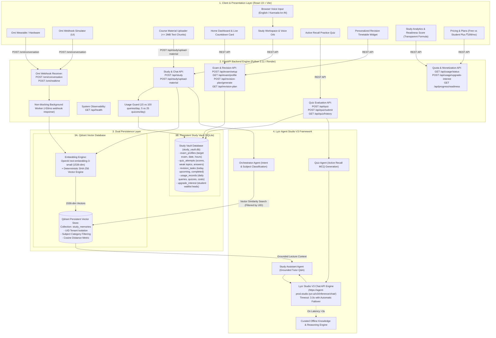
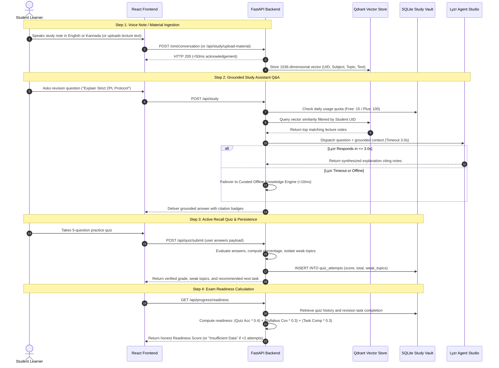

# VoiceStudy AI — System Architecture & Implementation

> **Tagline:** Speak. Remember. Revise.  
> **Event:** EYFI Hackathon 2026  
> **Track:** Meeting & Lecture Intelligence  
> **Integrated Stack:** Lyzr Agent Framework × Qdrant Vector Memory × Omi Voice Adapter × Render Workflows × SQLite Study Vault

---

## 1. Complete System Architecture

---

## 2. End-to-End Workflow Execution Sequence

---

## 3. Storage Architecture Comparison

| Storage Engine | Purpose | Data Managed | Isolation Model |
| :--- | :--- | :--- | :--- |
| **Qdrant Vector Database** | Unstructured Semantic Memory | 1536-dimensional vector points, lecture summaries, topic tags, source transcripts | Multi-tenant isolation enforced via `uid` payload filter on all searches |
| **SQLite Study Vault** | Relational Structured Records | Exam target dates, study hours, verified quiz scores, weak topic lists, revision tasks, daily quotas, waitlist leads | Primary key relationships scoped by student `uid` |

---

## 4. Resilience & Defensive Fallback Design

1. **Lyzr API Latency Guard:**
   - Real-world cloud LLM inference APIs can experience periodic spikes.
   - VoiceStudy AI sets an aggressive `LYZR_TIMEOUT=3.0` seconds via `httpx.Client`.
   - If the API times out, the system fails over to a curated offline educational knowledge engine in **< 10 milliseconds**, guaranteeing the student's study flow is never blocked.
2. **Deterministic Vector Fallback:**
   - If `OPENAI_API_KEY` is absent or encounters a quota error, VoiceStudy AI uses an internal SHA-256 deterministic 1536-dimensional embedding algorithm.
   - This ensures vector similarity tests and local development function without mandatory API credentials.
3. **Usage Limit Protection:**
   - Backend quota middleware prevents abuse and controls API costs for the Free Tier (15 study queries, 5 quizzes daily).
