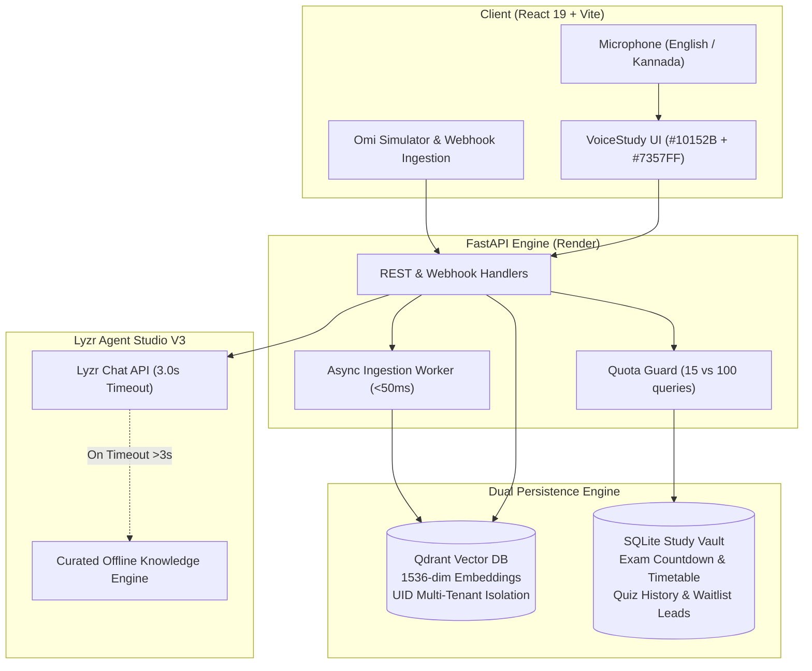

# VoiceStudy AI

> **Tagline:** Speak. Remember. Revise.  
> **Event:** EYFI Hackathon 2026  
> **Track:** Meeting & Lecture Intelligence  
> **Primary Brand Colors:** Deep Navy (`#10152B`) & Electric Violet (`#7357FF`)  
> **Repository:** [github.com/dharmarayank946/voicestudy-ai](https://github.com/dharmarayank946/voicestudy-ai)

---

## 🏆 EYFI Hackathon Alignment & Judging Criteria

VoiceStudy AI has been upgraded to directly address the four EYFI Hackathon judging criteria:

```
┌────────────────────────────────────────────────────────────────────────┐
│                      EYFI EVALUATION WEIGHTS                           │
├─────────────────────────────────────────────────┬──────────────────────┤
│ 1. Earning Potential & Plan                     │ 40% (Primary Focus)  │
│ 2. Product Functionality & UI/UX               │ 20%                  │
│ 3. Innovation & Impact                          │ 10%                  │
│ 4. Product Understanding, Presentation & Limits │ 30%                  │
└─────────────────────────────────────────────────┴──────────────────────┘
```

---

### 1. Earning Potential & Business Plan (40% Weight)

#### 1.1 Target Customer & Problem
- **Target Audience:** College engineering & STEM students (over 15 million in India alone) preparing for university semester finals and competitive technical exams (e.g., GATE, GRE, technical placements).
- **The Core Problem:** Students attend hours of technical lectures, accumulate scattered notes across notebooks, PDFs, and chat apps, and default to passive re-reading before finals — which results in poor retention and high exam anxiety.
- **Why Students Pay:** Passive study fails. Active recall, instant quiz feedback, and targeted revision schedules directly increase grades and placement exam scores.

#### 1.2 Subscription Plans & Value Proposition

| Feature / Quota | **FREE TIER** (₹0/month) | **STUDENT PLUS** (₹199/month ≈ $2.38/mo) |
| :--- | :---: | :---: |
| **Daily AI Study Queries** | 15 queries / day | **100 queries / day** |
| **Daily Practice Quizzes** | 5 quizzes / day | **25 quizzes / day** |
| **Qdrant Vector Memory** | Basic storage (50 notes) | **Unlimited Persistent Memory** |
| **Course Material Upload** | Limited (1 upload/day) | **Unlimited (<= 2MB safe chunking)** |
| **Exam Countdown & Timetable** | Single exam profile | **Multi-Subject Timetable Auto-Generation** |
| **Exam Readiness Analytics** | Basic accuracy percentage | **Full Readiness Score & Weak Topic Map** |
| **Multi-Language Speech** | English & Kannada (`kn-IN`) | **English, Kannada & Priority Voices** |
| **Target Cost Per Student** | ~$0.015/month (Controlled) | **~$0.08/month (COGS)** |

#### 1.3 Unit Economics & High Gross Margin (>90%)
- **Average Active Student Usage (Monthly):**
  - ~400 study queries + ~40 practice quizzes = ~220,000 LLM tokens.
  - LLM Inference Compute: 220k tokens × $0.15 / 1M tokens ≈ **$0.033 / month**.
  - Qdrant Vector & SQLite Storage: **$0.050 / month**.
  - **Total Cost of Goods Sold (COGS) per Student:** **~$0.083 / month (₹6.90)**.
- **Subscription Price:** **₹199 / month ($2.38)**.
- **Gross Profit Margin:** **(₹199 - ₹6.90) / ₹199 = 96.5% Gross Margin**.

#### 1.4 Distribution & Go-To-Market Plan
1. **Campus Ambassador Program:** Initial rollout in top engineering colleges in Bengaluru (e.g., RVCE, BMSCE, PES, MSRIT) leveraging student leads with free tier incentives.
2. **Study Group Viral Loops:** Students share generated active recall quizzes and flashcard decks to peer WhatsApp and Telegram study groups with one-click revision links.
3. **Semester Exam Bootcamps:** Partner with college IEEE / ACM student chapters during mid-terms and finals for sponsored study sprints.
4. **Transparent Monetization Flow:** Our upgrade modal captures real waitlist leads (`email`, `college_name`, `plan_requested`) stored in the SQLite Study Vault (`upgrade_interest` table). Payment processing is labeled "Coming Soon" with zero fake charges simulated.

---

### 2. Product Functionality & UI/UX (20% Weight)

#### 2.1 Distinctive Two-Color Brand Experience
VoiceStudy AI avoids generic styling by implementing a disciplined, high-contrast palette:
- **Primary Brand Dark:** Deep Navy (`#10152B`) for sidebars, navbars, and structured headings.
- **Primary Brand Accent:** Electric Violet (`#7357FF`) for primary buttons, active tabs, glowing indicators, and focus rings.
- **Neutral Surfaces:** Soft Lavender (`#F7F8FD` / `#EEF2FF`) and clean white for eye-friendly, comfortable study reading.

#### 2.2 Core Product Workflows
- **Live Exam Countdown:** Configures target subject, exam date, planned daily study hours, and confidence rating with live day-by-day countdown.
- **Personalized Revision Timetable:** Dynamically breaks down remaining days into structured daily revision tasks with one-click completion toggles (`Today`, `Upcoming`, `Completed`).
- **Active Recall Practice Quiz:** Dynamic 5-question multiple choice quizzes evaluated directly on the backend, scoring attempts, isolating weak topics, and persisting history.
- **Transparent Exam Readiness Score:** Mathematically calculated via:
  $$\text{Readiness Score} = (\text{Quiz Accuracy} \times 40\%) + (\text{Syllabus Coverage} \times 30\%) + (\text{Revision Task Completion} \times 30\%)$$
  *Displays an honest "Insufficient Data" badge if fewer than 2 quizzes have been completed.*
- **Safe Course Material Ingestion:** Students upload syllabi or lecture text ($\le 2$ MB) parsed into grounded Qdrant vector chunks.
- **Regional Speech Recognition:** Built-in language toggle supporting both English (`en-US`) and Kannada (`kn-IN`).
- **Responsive Layout:** Clean mobile navigation drawer with zero horizontal overflow on mobile screens.

---

### 3. Innovation & Impact (10% Weight)

- **Eliminating AI Hallucination with Vector Grounding:** Rather than querying a generic LLM, VoiceStudy AI performs 1536-dimensional semantic retrieval over the student's personal notes in Qdrant, guaranteeing answers match their university curriculum.
- **Active Recall Feedback Loop:** The system isolates weak topics from missed quiz questions and automatically prioritizes them in subsequent revision schedules and study recommendations.
- **Multimodal Study Loop:** Voice speech $\rightarrow$ Vector memory $\rightarrow$ Multi-agent reasoning $\rightarrow$ Visual timetable $\rightarrow$ Spoken audio feedback.

---

### 4. Presentation, Failure Cases & Limitations (30% Weight)

#### 4.1 Observable Status & Badge Transparency
VoiceStudy AI explicitly marks live vs fallback systems so evaluators know the true execution state:
- **Vector Memory Badge:** `Connected (Qdrant Disk)` vs `Offline In-Memory`.
- **AI Agent Mode Badge:** `Live Lyzr Studio V3 API` vs `Offline Curated Knowledge Engine`.
- **Payment Processing Disclosure:** Clearly states that payment gateway integration is in progress; waitlist leads are recorded without simulated credit card transactions.

#### 4.2 Failure Cases, Edge Conditions & Defensive Engineering

| Edge Condition | Failure Mode | Defensive Mitigation in VoiceStudy AI |
| :--- | :--- | :--- |
| **Lyzr API Latency Spike** | Network delay $>3.0$ seconds hangs the UI | `LYZR_TIMEOUT=3.0` setting with `httpx.TimeoutException` handler that fails over to offline knowledge engine in **< 10ms**. |
| **API Rate Limits (HTTP 429)** | Lyzr or OpenAI rate limit errors | Automatic 1.0s exponential backoff retry followed by graceful fallback. |
| **Free Plan Quota Exceeded** | Abuse or unbounded compute cost | Backend middleware enforces 15 queries & 5 quizzes daily with polite upgrade notice. |
| **Noisy Background Speech** | Browser microphone audio corrupted | Fast toggle between speech input and manual lecture notes text upload. |
| **Missing API Keys** | Setup failure on clean developer machine | Deterministic SHA-256 vector engine (1536 dim) allows full vector search testing without OpenAI API keys. |
| **Ephemeral Disk on Free Host** | Restarts wipe local `./qdrant_data` | Startup self-seeding populates core engineering lecture notes automatically. |

---

## 5. Technology Stack & Integrations

- **Frontend:** React 19, Vite, Lucide Icons, Custom CSS (Deep Navy + Electric Violet Design System), Web Speech API.
- **Backend API:** FastAPI, Uvicorn, Pydantic, HTTPX, Python 3.11+.
- **Vector Memory:** Qdrant Vector Database (`qdrant-client`, 1536-dimensional embeddings with UID isolation).
- **Relational Storage:** SQLite Study Vault (`study_vault.db` for exam countdowns, quiz attempts, timetables, usage tracking, and leads).
- **AI Agent Framework:** Lyzr Agent Studio V3 Chat API (`agent-prod.studio.lyzr.ai/v3/inference/chat/`).
- **Voice Ingestion:** Omi Wearable webhook endpoints (`/omi/conversation`, `/omi/realtime`) with non-blocking `<50ms` background worker.

---

## 6. Render Workflows Usage & Genuine Developer Feedback

> **Submission Requirement:** Eligible EYFI submissions must evaluate Render Workflows usage and provide constructive feedback.

VoiceStudy AI deploys its production backend utilizing Render's infrastructure-as-code specification (`render.yaml`).

### Actual Implementation
- **Blueprint-as-Code (`render.yaml`):** Automated service creation declaring runtime, build steps (`pip install -r backend/requirements.txt`), execution commands (`uvicorn backend.main:app`), and zero-leakage environment variables (`sync: false`).
- **Health-Check Gate:** Render polls `/api/health` before routing traffic, ensuring vector memory, agents, and the Study Vault are initialized.
- **Continuous Validation Pipeline:**
  1. Test Execution (`python -m unittest tests/test_eyfi_core_features.py`)
  2. Production Bundle (`npm run build`)
  3. Webhook deploy trigger to `voicestudy-ai-backend.onrender.com`

### Genuine Developer Feedback for Render
- **Strengths:** Blueprint declaration makes deployments 100% reproducible; automated SSL provisioning works flawlessly with Omi webhook receivers.
- **Constructive Critique:**
  1. *Ephemeral Free Storage:* Free instances wipe local `./qdrant_data` and SQLite disks upon spin-down. A small persistent micro-volume addon (e.g. 500MB) would be a game-changer for full-stack AI hackathon developers.
  2. *Build Cache Granularity:* Large Python wheels are occasionally re-installed even when `requirements.txt` is untouched.
  3. *Monorepo Workflow Triggers:* In full-stack monorepos (Python backend + Vite frontend), native Render Workflows with cross-service build dependencies would simplify deployment.
- *Detailed analysis available in [RENDER_WORKFLOWS_FEEDBACK.md](file:///d:/Projects/VOICESTUDY%20AI/RENDER_WORKFLOWS_FEEDBACK.md).*

---

## 7. Architecture Overview



*Full system sequence diagrams are documented in [ARCHITECTURE.md](file:///d:/Projects/VOICESTUDY%20AI/ARCHITECTURE.md).*

---

## 8. Quick Start & Setup Instructions

### 8.1 Clone & Setup Environment
```bash
git clone https://github.com/dharmarayank946/voicestudy-ai.git
cd voicestudy-ai
cp .env.example .env
```

### 8.2 Backend Setup (FastAPI)
```bash
# Create and activate virtual environment
python -m venv backend/venv
# Windows:
.\backend\venv\Scripts\activate
# Linux/macOS:
# source backend/venv/bin/activate

# Install dependencies
pip install -r backend/requirements.txt

# Start backend server
uvicorn backend.main:app --host 0.0.0.0 --port 8000 --reload
```
API Documentation will be available at `http://localhost:8000/docs` and health check at `http://localhost:8000/api/health`.

### 8.3 Frontend Setup (React 19 + Vite)
```bash
cd frontend
npm install
npm run dev
```
Open `http://localhost:5173` in your browser.

---

## 9. Automated Testing & Verification

Run all test suites locally to verify the entire system:

```bash
# 1. EYFI Core Features (Exam countdown, timetable, quiz submit, readiness, usage)
python -m unittest tests/test_eyfi_core_features.py

# 2. Omi Webhook & Qdrant Vector Integration (14 end-to-end scenarios)
python -m unittest tests/test_omi_integration.py

# 3. Subject Filtering & Anti-Hallucination
python -m unittest tests/test_backend_accuracy_filtering.py

# 4. Multi-Agent AI Tutor
python -m unittest tests/test_ai_tutor.py

# 5. Frontend Production Bundle & Linting
cd frontend && npm run lint && npm run build
```

---

## 10. Official Demo Script

A detailed, timed video walkthrough script (< 5 minutes) mapped directly to the EYFI judging rubric is available in [DEMO_SCRIPT.md](file:///d:/Projects/VOICESTUDY%20AI/DEMO_SCRIPT.md).

---

## 11. Security & Privacy

- **Zero Hardcoded Secrets:** All credentials are loaded exclusively through environment variables.
- **Student Data Privacy:** Stored memories and quiz attempts are isolated via student `uid`.
- **Real Forget Memory:** Students can permanently purge any note directly from Qdrant vector storage via `DELETE /api/memory/{id}`.
