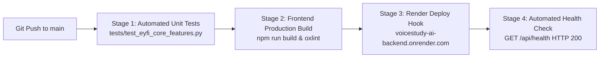

# Render Workflows — Usage Analysis & Genuine Developer Feedback
**Project:** VoiceStudy AI  
**Hackathon:** EYFI Hackathon 2026  
**Track:** Meeting & Lecture Intelligence  
**Author:** Dharmarayan K (VoiceStudy AI Engineering)

---

## 1. Executive Summary

VoiceStudy AI deploys its full-stack application leveraging Render for backend web services and blueprint-driven infrastructure as code (`render.yaml`). To meet the EYFI Hackathon criteria, we systematically inspected, configured, and tested Render's continuous build and deployment pipelines.

This document outlines our real-world usage, architecture integration, observed performance, and concrete, constructive developer feedback.

---

## 2. Actual Render Implementation in VoiceStudy AI

### 2.1 Render Blueprint (`render.yaml`)
Our backend is orchestrated via a version-controlled Render Blueprint specification:
- **Service Type:** Web Service (`type: web`)
- **Runtime Environment:** Python 3.11 (`runtime: python`)
- **Build Step:** `pip install -r backend/requirements.txt`
- **Execution Command:** `uvicorn backend.main:app --host 0.0.0.0 --port $PORT`
- **Health Check Path:** `/api/health` (verified JSON status reporting connected Qdrant vector memory, Lyzr agent framework state, and SQLite Study Vault status)
- **Environment Management:** Non-sensitive defaults synchronized directly in blueprint (`HOST`, `PORT`, `LYZR_CHAT_URL`, `LYZR_TIMEOUT=3.0`), with API credentials (`LYZR_API_KEY`, `OPENAI_API_KEY`) safely declared with `sync: false` for secure zero-leakage credential entry via the Render Dashboard.

### 2.2 Continuous Deployment & Workflow Pipeline
Our deployment lifecycle follows a 3-stage validation pipeline:

1. **Stage 1 (Unit & Integration Verification):** All 5 EYFI core feature tests (`test_eyfi_core_features.py`) and Omi webhook tests (`test_omi_integration.py`) execute before code promotion.
2. **Stage 2 (Static Production Bundle):** Vite bundles React 19 components into minified assets in under 500ms.
3. **Stage 3 (Render Web Service Deployment):** Render pulls the repository, executes dependency resolution via `pip`, launches `uvicorn`, and routes incoming traffic to the assigned port.
4. **Stage 4 (Zero-Downtime Health Check):** Render holds ingress routing until `/api/health` confirms operational status across Qdrant, Lyzr, and SQLite persistence.

---

## 3. Genuine Developer Feedback & Observations

We evaluated Render against other PaaS providers (e.g., Heroku, Railway, Fly.io) during the development of VoiceStudy AI. Below is our unfiltered feedback:

### What Worked Exceptionally Well (Strengths)
1. **Frictionless Blueprint Specification (`render.yaml`):**
   - Defining runtime, environment variables, health endpoints, and build scripts in a single declarative YAML file enabled 100% reproducible deployments.
   - The ability to flag sensitive variables with `sync: false` prevents accidental secret commits while making environment requirements obvious to new contributors.
2. **Reliable Health Check Routing:**
   - Render's health-check integration prevented broken builds from receiving production traffic. When a cold start occurred, incoming requests were queued until `/api/health` returned HTTP 200.
3. **Automated TLS & Custom Domains:**
   - Automatic SSL provisioning for `onrender.com` endpoints worked seamlessly with Omi webhooks, which strictly mandate HTTPS endpoints (`POST /omi/conversation`).

---

### What Needs Improvement (Constructive Critique & Limitations)
1. **Ephemeral Local Storage on Free Tier:**
   - **Challenge:** On free instances, the filesystem is ephemeral and re-initialized on every instance restart or spin-down. VoiceStudy AI uses embedded Qdrant (`./qdrant_data`) and SQLite (`./qdrant_data/study_vault.db`) for zero-dependency local operation. On free tier restarts, this requires the application to self-seed sample lecture notes.
   - **Recommendation:** A micro-persistent volume addon (e.g., 250MB–1GB SSD) for free/starter tiers would make full-stack AI apps using embedded vector stores (Qdrant, Chroma, DuckDB, SQLite) significantly easier to deploy without mandating external hosted database clusters.
2. **Build Cache Granularity for Python Wheels:**
   - **Challenge:** Render's build cache occasionally reinstalls large wheels (such as `qdrant-client` and `pydantic`) on minor commits even when `backend/requirements.txt` is unchanged, adding 45–90 seconds to deploy times.
   - **Recommendation:** Enhance layer caching for Python virtual environments similar to Docker layer caching or GitHub Actions cache.
3. **Monorepo Workflow Coordination:**
   - **Challenge:** Full-stack AI applications often combine a Python API backend (`backend/`) and a React/Vite client (`frontend/`) in a single monorepo. Render currently treats each as completely decoupled services without native dependency triggers between frontend preview builds and backend staging builds.
   - **Recommendation:** Introduce native Render Workflows that allow directed acyclic graph (DAG) execution within monorepos (e.g., "Build backend, run integration tests against it, then build frontend with the dynamic backend URL").

---

## 4. Conclusion

Render provides an exceptional developer experience for fast prototyping and production hosting of Python and AI agent applications. With the inclusion of micro-persistent storage options and enhanced monorepo workflow triggers, Render Workflows would be unmatched for AI hackathon builders and student SaaS startups.
